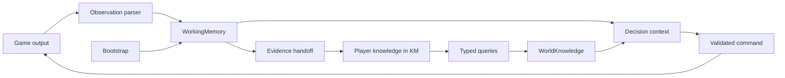

# Working memory and world knowledge integration plan

Date: 2026-11-27

## Recommendation

Make **WorkingMemory the authoritative record of the live session**, **Knowledge Machine (KM) the retained knowledge and inference system**, and **WorldKnowledge a typed local view populated by bootstrap and KM queries**.

The main refactor establishes ownership, freshness, and synchronization rules. Adding periodic KM assertions without these changes would preserve stale state and duplicate sources of truth.

## Scope and evidence

The analysis covers the current working tree of this runtime, including the uncommitted command-situation integration, the component library at `E:/IdeaProjects/som-knowledge-machine/src/resources/som-component-library`, and the relevant NLP-service and modulith contracts. Companion repositories were inspected without modification. The analysis itself did not change runtime source.

The local source contracts do not establish the deployed service or packaged library versions. Existing proposals describe intended behavior; runtime source and tests establish current behavior.

## Implementation at analysis time

This section records the source state examined before implementation. The completion notes and tracking table below identify changes made afterward; the reference documents describe the current runtime.

| Component | Current responsibility | Mismatch with the intended architecture |
| --- | --- | --- |
| `WorkingMemory` | Accumulates beings, rooms, commands, considers, and conversations | Mixes live observations, historical knowledge, parsing, serialization, and fixture writing |
| `WorldKnowledge` | Stores bootstrap output and a character snapshot | Includes transient presence and one room; has no KM query population path |
| `GameplayEngine` | Observes, maintains session state, asks KM, and sends commands | Owns important memory outside `WorkingMemory` |
| `CommandSituation` | Copies learned commands into the player's KM situation | First useful integration adapter, but limited to commands |
| `MemoryClient` / `KnowledgeClient` | Load and replace modulith snapshots | Snapshot storage does not provide inference or evidence synchronization |
| `KmPlayer` | Addresses a retained player situation | Provides the correct isolation boundary, but lacks save and lifecycle coordination |

### Retained decisions reuse request identities

`GameplayEngine._ask` now sends expressions into the retained player situation, while `LevelQuestion` repeatedly writes `*Goal`, `*Clock`, `*View`, and `*MobileN` using `has`. The component contracts require changing facts to use replacement semantics and changed questions to receive fresh request frames. Reusing these identities risks retaining earlier inputs or cached conclusions. Existing fake-client tests verify routing but cannot establish correct KM cache behavior.

Sources: [GameplayEngine](../../src/play/GameplayEngine.py), [LevelQuestion](../../src/play/LevelQuestion.py), and the [mobile validity contract](E:/IdeaProjects/som-knowledge-machine/src/resources/som-component-library/mobile/README.md).

### The session is split across multiple owners

The clock, current room, tried exits, fresh considers, engaged targets, and threats live on `GameplayEngine`. They are absent from the working-memory checkpoint and operator review. Recreating the engine loses those facts even though other session records can be restored.

Sources: [GameplayEngine](../../src/play/GameplayEngine.py) and [PlayClock](../../src/memory/PlayClock.py), moved from `src/play` during step 2.

### Accumulated sightings can be mistaken for current presence

`_observe_room` adds mobiles without replacing the room's current occupants. `_readings` selects remembered mobiles by room name. A disappeared mobile can remain eligible after another look. Name-only keys also collapse distinct same-named beings and rooms. `remember_room` cannot replace known exits with an explicitly empty list because it checks `if exits`.

Sources: [GameplayEngine](../../src/play/GameplayEngine.py) and [WorkingMemory](../../src/memory/WorkingMemory.py).

### Bootstrap persistence depends on whether Ollama ran

Successful model-derived categories and help remain in working memory when defer is false. Raw-server mode publishes commands to WorldKnowledge. A later whole-document save can therefore discard previously stored command knowledge.

Source: [Bootstrapper](../../src/play/Bootstrapper.py).

### Help can become an executable command catalog

`WorldKnowledge.command_records` synthesizes commands from help topics, and startup copies those into working memory. Help availability and current command availability are different evidence. The new `CommandSituation` excludes synthesized help rows when reading explicit knowledge records but accesses private dictionaries to do so.

Sources: [WorldKnowledge](../../src/play/WorldKnowledge.py), [startup](../../src/main.py), and [CommandSituation](../../src/play/CommandSituation.py).

### Persistence is incomplete and documentation needs updating

Working memory is saved after bootstrap and on process exit, with no periodic handoff. The NLP service now has `POST /km/players/{player}/save`, which the runtime does not expose. That save writes an external player resource; service restart does **not** automatically reload it.

Sources: [startup and shutdown](../../src/main.py), [KmClient](../../src/net/rest/KmClient.py), and the [KM API contract](E:/IdeaProjects/som-nlp-service/docs/km-api.md).

## Target ownership

| Information | Authoritative owner | Other representations |
| --- | --- | --- |
| Current room, occupants, combat, vitals, and current equipment | WorkingMemory | Fresh KM input projections |
| Session progress, pending actions, and conversations | WorkingMemory | Checkpoint; supported KM projections |
| Learned commands, help, explored map, encounter history, and gear sources | Retained player knowledge in KM after acceptance | WorldKnowledge cache |
| Observations awaiting handoff | WorkingMemory's pending evidence | Recoverable runtime checkpoint |
| Routes, selected targets, and proposed gear strategies | KM conclusions for a particular request | Revision-tagged WorldKnowledge query results |
| Predicted ownership or successful movement | Never an observed fact | Remains a proposal until server output confirms it |

This preserves fast local gameplay state while allowing knowledge to accumulate across sessions.

## Step-by-step implementation plan

### 1. Define the integration contract

Update the [existing memory proposal](../proposals/Memory.md) to reflect the target ownership model. Define:

- Session identity: agent, account, character ID/name, and session ID.
- Observation identity, ordering, source, and observation time.
- The distinction between current facts, historical observations, and inferred conclusions.
- Separate milestones for acceptance into KM and durable save.

Bind each gameplay session to the actual logged-on character. The current KM player is chosen from the agent document before operator-driven connection and logon, so synchronization must reject a mismatched account or character.

**Acceptance:** no observation or restored checkpoint can silently enter another character's situation.

### 2. Move live session state into WorkingMemory

Give WorkingMemory cohesive state objects for current room/presence, combat, progress, and pending action. Move the engine's clock and freshness/travel markers into those objects.

Keep parsing and orchestration outside these domain objects. Move `observe_line` and `absorb_world` into the play observation layer, removing WorkingMemory's dependency on `play.WorldReader`.

Preserve useful domain records such as `Conversation` and `ConsiderOpponent`. Do not introduce a generic section registry.

**Acceptance:** recreating GameplayEngine around the same memory preserves session state, and the operator memory review describes the complete session.

### 3. Introduce observation replacement and identity rules

A complete look replaces current room occupants and exits. Historical sightings remain separately available for handoff.

Distinguish omitted data from known empty data:

- Omitted exits: no new information.
- Empty exits: observed no exits.
- Missing aggression flag: unknown.
- Explicit false aggression: observed nonaggressive evidence.

Assign stable internal IDs to rooms, exits, encounters, and gear. Display names remain labels. Where telnet supplies insufficient identity evidence, retain separate provisional records rather than merging them by name.

**Acceptance:** two identical room titles or two goblins remain distinguishable; a departed mobile is absent from current tactical readings.

### 4. Separate command knowledge from current availability

Use one command value type and one ordered collection implementation. WorldKnowledge holds learned command descriptions; WorkingMemory records availability observed for this session.

Expose public APIs for stored command rows. Remove private-field access from `CommandSituation`.

Keep help-topic fallback as legacy document handling, but stop treating it as proof that a verb is executable. Preserve command ordering, category precedence, and prohibited-command checks.

**Acceptance:** help for a verb cannot authorize sending it; refreshing availability can remove a previously available verb.

### 5. Unify bootstrap and gameplay evidence

Preserve command order and prompt synchronization. Change bootstrap's destination:

- Login text becomes session evidence.
- Commands/help become learned knowledge plus current availability.
- Areas become listed-area evidence.
- `who` and `look` become current observations.
- Model extraction becomes attributed enrichment of server evidence.

Defer mode controls model enrichment, not whether learned knowledge survives.

Use the same handoff path for initial bootstrap, forced bootstrap, and subsequent gameplay. Assert `som-bootstrap` only after the agreed required evidence has been accepted.

**Acceptance:** both bootstrap modes retain command knowledge; partial bootstrap remains distinguishable from completion.

### 6. Add an evidence-to-KM adapter

Extend the command integration into a small set of explicit mappings:

| Runtime evidence | Existing KM vocabulary |
| --- | --- |
| Commands | `Som-Known-Command`, `som-known-command` |
| Areas | `Som-Area`, projection `som-area` |
| Explored rooms and directed exits | `Som-Explored-Room`, `Som-Room-Exit`, `som-explored-room` |
| Historical encounters | `Som-Mobile`, `som-known-mobile` |
| Current tactical sightings | Fresh `Som-Mobile-Reading` frames |
| Confirmed inventory/equipment | `Som-Gear-State` |
| Gear opportunities | `Som-Gear-Source`, `som-known-gear-source` |

Use `now-has` for changed values and ordered sequences. Keep KM encoding, reserved-symbol handling, and printed-answer parsing in the integration boundary.

Do not invent mappings for conversations or other unsupported records. Keep those locally until their contracts exist.

**Acceptance:** deterministic expression tests cover ordering, replacement, explicit emptiness, quoting, and player isolation.

### 7. Implement periodic handoff with retries

Add a coordinator that reads pending observations, builds a bounded batch, submits it, and acknowledges only successful work.

Trigger handoff:

- Periodically by elapsed time or pending volume.
- After bootstrap.
- Before a knowledge-dependent query when relevant evidence is pending.
- On idle transition and graceful shutdown.

Preserve live state after handoff. Only acknowledged pending evidence becomes eligible for compaction.

Use deterministic identities and replacement operations so retries are safe. The existing service commits individual expressions, so a multi-call batch is not atomic. On partial failure, retain pending work and prevent dependent decisions until synchronization completes.

Keep scheduling on the existing drive lifecycle initially. Add a maintenance hook while idle. Avoid a background writer until latency measurements justify its concurrency cost. Keep ordinary thresholds and tuning data-driven, subject to the agent document's supported contract.

**Acceptance:** failure halfway through a batch loses nothing; retry produces the same indexed knowledge.

### 8. Fix inference request freshness

Parameterize `LevelQuestion` with unique request identities. Create fresh goal/progress/view and reading frames for each changed question. Do the same for route, aggression, and regear requests.

Associate every result with the session and evidence revision that produced it. Reject results when relevant observations change.

Keep baseline evaluation for isolated questions only. It cannot see retained player assertions; production queries that depend on learned knowledge use the player situation.

**Acceptance:** a second decision after a changed score, vanished mobile, or edited map reflects the new evidence without restarting KM.

### 9. Turn WorldKnowledge into a typed knowledge view

Retain its useful lookup role, but separate methods for:

- Applying bootstrap-derived knowledge.
- Reading learned facts from KM.
- Holding typed conclusions with request and evidence revisions.
- Invalidating affected query results.

Add narrow queries for commands, area choice, routes, remembered mobile destinations, and gear recovery. Do not download the entire KM situation for each step.

Preserve meaningful result distinctions: `nil`, an empty sequence, incomplete evidence, blocked planning, and completion remain distinguishable. A simple structured KM syntax reader is warranted as results become nested; the current attempt regex is too narrow for this boundary.

**Acceptance:** callers receive typed facts and conclusions without handling raw KM syntax or confusing absence with a negative answer.

### 10. Connect conclusions to feedback-driven gameplay

First preserve the current level loop using fresh requests. Then add, in order:

1. Known-route execution.
2. Investigation of remembered experience sources.
3. Aggression assessment along a proposed route.
4. Gear recovery proposals.

Execute at most one validated action, observe its outcome, update WorkingMemory, and reconsider. A historical mobile location does not establish presence; a route does not establish traversability; a gear projection does not establish ownership.

Parse observed experience and attribute it to an encounter only when the evidence supports that association. Current code drains experience messages without recording mobile yield.

The [route](E:/IdeaProjects/som-knowledge-machine/src/resources/som-component-library/route/README.md), [mobile](E:/IdeaProjects/som-knowledge-machine/src/resources/som-component-library/mobile/README.md), and [gear contracts](E:/IdeaProjects/som-knowledge-machine/src/resources/som-component-library/gear/README.md) support these boundaries.

**Acceptance:** refused movement, absent targets, failed purchases, and equipment loss update evidence before another attempt.

### 11. Separate session checkpoints from KM persistence

Add a runtime client method for the existing player-save endpoint. Track durable save success independently from successful assertions.

The current modulith contract is insufficient for richer runtime checkpoints: its memory document lacks session IDs, progress, pending evidence, and even room items; its knowledge document lacks the explored map and inference metadata. Sources: [MemoryDocument](E:/IdeaProjects/som-server-modulith/src/main/java/org/springy/som/modulith/memory/internal/MemoryDocument.java) and [KnowledgeDocument](E:/IdeaProjects/som-server-modulith/src/main/java/org/springy/som/modulith/knowledge/internal/KnowledgeDocument.java).

Implement a versioned runtime-owned checkpoint for unsupported state if crash recovery is included in the iteration. Keep existing REST bodies compatible rather than assuming additional fields survive.

Automatic recovery of saved KM resources remains a service lifecycle gap. Successful export is not automatic restart recovery. Report missing service capabilities without modifying companion repositories.

**Acceptance:** restart restores pending work but requires fresh observations before trusting presence, combat, or equipment availability.

### 12. Migrate and verify

Read legacy memory and knowledge documents through adapters. Import historical snapshots as historical evidence, never as current presence. Preserve existing snapshots until migration succeeds.

Add focused regression coverage for:

- Fresh inference requests after changed evidence.
- Same-named rooms and encounters.
- Empty versus unknown observations.
- Partial handoff and replay.
- Session and player isolation.
- Confirmed versus predicted equipment.
- Old snapshot migration and stale checkpoint restoration.
- Assertion success followed by durable-save failure.

Update the architecture, bootstrap, memory, knowledge, play, and testing references with each implemented phase. Follow the repository's compact Python and one-behavioral-class-per-file conventions.

**Acceptance:** migration preserves known data, focused tests pass, integration tests establish actual KM semantics, and reference documentation describes the implemented behavior.

## Delivery milestones

The first implementation milestone ends after steps 1–8: complete local session ownership, consistent bootstrap evidence, retryable handoff, and fresh retained-player inference. Route and gear integration follows once that foundation is verified.

Steps 9–10 add typed knowledge queries and their gameplay consumers. Step 11 distinguishes accepted knowledge from durable recovery. Step 12 applies throughout implementation and closes migration and documentation work.

No companion repository changes are included. Service schema expansion and automatic KM resource restoration require separately authorized companion work if selected later.

## Verification performed

On 2026-11-27, **86 focused existing tests passed** using `.venv/Scripts/python.exe` and a writable temporary directory. The default `python` command encountered an ActiveState launcher permissions failure; the initial project-interpreter run encountered four temporary-directory permissions errors. Rerunning the same focused suite with a writable temporary directory passed.

The suite covered memory review, commands, world absorption, considers, aggression, auras, conversations, memory and knowledge clients, bootstrap, KM clients and player identity, level questions, gameplay, command-situation assertions, and initial bootstrap.

These tests establish current runtime behavior. They do not validate live KM inference, deployed component versions, or automatic service restart recovery. No live gameplay tests or companion builds were run.

## Step 2 completion notes

Completed on 2026-11-27. WorkingMemory now owns a live PlaySession composed of PlayClock progress, RoomVisit, CombatState, and optional PendingAction. The latest prompt and unusable-reply markers also live on this session. GameplayEngine uses these records directly, including after engine recreation or an explicit memory clear. Existing room hints cannot replace an already established visit with an old knowledge snapshot.

Score and fighting-you parsing and bootstrap snapshot copying now live in `play.MemoryObservation`; the memory package no longer imports play. The new domain state records own their transitions and provide `from_json` boundaries. The operator review includes a JSON-serializable live session. The legacy memory REST body deliberately omits that unsupported section and does not restore it from old documents. Durable checkpointing, identity guards, stable entity IDs, and presence replacement remain later work.

Interrupted exchanges retain their pending action and whether a response returned. Recreated engines continue observing but do not resend that command automatically. Successful exchanges clear the pending action only after folding the reply. Recovery beyond this conservative hold remains later work.

Verification: 115 focused tests passed, including 10 added regression tests for recreation, prompt-based danger handling, tried exits and threat markers, interrupted exchanges, memory clear, serialization, legacy restore boundaries, score transitions, and combat projections. A broader offline run completed 178 tests: 176 passed, with one failure and one error in untouched agent fixture/config tests. Both were reproduced from an isolated HEAD snapshot: the fixture lacks the expected `example-agent`, and agent.yml uses the dragon NLP origin while a test expects localhost. A separate socket-test run was interrupted after errors and did not complete. An isolated socket round-trip test then confirmed a connection PermissionError (WinError 10013); no socket or live-game test success is claimed. All 22 changed or untracked Python files compiled, the memory package has no play imports, and 32 local documentation links resolved.

## Step 3 completion notes

Completed on 2026-11-27. Rooms, beings, exits, and item sightings now have generated IDs independent of their labels. The behavioral dataclasses live in their own files with `from_json` boundaries. Current room visits reference occupant IDs; the accumulated registries retain history. ID lookups are explicit, singular name lookups return no result on ambiguity, and name-only mutation rejects ambiguity. Unknown aggression and door requirements remain nullable; explicit false and empty values replace stored values while omitted fields preserve them.

Complete prompt-framed looks replace current occupants, exits, and raw object sightings. Disappeared beings and removed items/exits stay in history. Unique continuous sightings may keep provisional IDs; duplicate indistinguishable sightings, disappearances, and separate visits receive separate records. Consider freshness, target actions, and combat markers refer to encounter IDs. Historical, unknown, player, or ambiguous encounters cannot be accepted as current kill/consider targets. Explicit consider absence removes only its target, and failed looks do not authorize old presence or exits.

Bootstrap applies the raw room observation before its legacy WorldKnowledge snapshot can collapse duplicate labels. Look enrichment is checked against source room ID and observation revision; delayed replies cannot overwrite a newer look. Distinct observed objects are retained when a model offers fewer entries. Raw object display lines are not assumed to be valid look keywords. Item IDs and keywords can survive unambiguous enrichment and subsequent matching looks, without establishing ownership.

Directional commands establish forward connections only when their own reply supplies a complete destination observation. Recognized refusals retain the origin and record only observed door requirements. Uncertain movement requires a new look without inferring a connection; reverse exits are not invented. Same-title movement creates a separate provisional visit. Failed fleeing no longer clears the fight. Prompt-framed drain metadata prevents partial room replacement and preserves queued-page order; recognizable room fragments survive engine recreation, while ordinary unprompted messages do not stall gameplay. A narrow KM attempt-parser fix prevents closing parentheses from becoming part of unquoted target names.

IDs remain local/provisional because this telnet contract provides no authoritative room, encounter, or gear identifiers. Silent same-title relocations and unseen replacements cannot be proven from labels alone. Revisits are not automatically merged by name. The legacy REST projection retains its supported shape, strips new metadata, and restores duplicate rows only as separate historical records with new IDs. Full account/character session binding, durable ID recovery, knowledge handoff, and KM map/gear execution remain later work. No companion repository was changed.

Verification: 150 focused tests passed, including 30 new step-3 tests covering replacement, identity, framing, movement, enrichment, and unquoted KM arguments. The broader offline run completed 208 tests: 206 passed; the same two agent fixture/config failures documented and baseline-verified in step 2 remain outside this change. All 31 changed/untracked Python files compiled, the memory package has no play imports, 34 local documentation links resolved, and `git diff --check` passed. Live game/KM calls and the previously restricted socket integration were not run for this step.

## Step 4 completion notes

Completed on 2026-11-27. KnownCommand is the single immutable command value, and CommandList is the single ordered collection implementing normalization, blank-preserving updates, atomic replacement, and primary/fallback merge precedence. SessionCommand, CommandRecord, and LearnedCommand were removed. WorldKnowledge owns explicit learned description rows. Bootstrap/restoration bind the legacy memory description view to the same collection, and CommandCategorizer writes knowledge. Clearing memory detaches that compatibility view without deleting world knowledge.

PlaySession owns a separate name-only availability collection and an observed/unknown flag. Only a complete parsed server command-list response refreshes it. Metadata updates, help topics, help-index categories, and legacy memory/knowledge restoration cannot grant permission. Refresh can revoke verbs or the whole list while retaining their descriptions. GameplayEngine checks current availability for every command, including safety choices, and preserves the prohibited-command checks. Current availability is visible in session review and omitted from both legacy REST documents.

A restored login now consumes the login prompt and performs one fresh commands exchange before engine creation, without repeating the full help bootstrap. The synchronized channel is reused by the engine. Matching legacy help can fill a description after its verb is observed. Verification failure leaves availability unknown. Command rows must have server-shaped column separation; ordinary refusal/help prose cannot be split into executable words, while punctuation aliases do not cause adjacent valid columns to be dropped.

CommandSituation uses public stored-record APIs and projects descriptions onto observed availability in server order. The existing nonblank memory metadata precedence is retained, with knowledge filling gaps. Unavailable knowledge-only names and synthesized help rows are excluded. Unknown availability submits nothing; an observed empty list replaces the retained KM index with an empty sequence. Later catalog publications replace command metadata as well as membership. No external KM assertion or live gameplay was performed during this implementation.

Owning bootstrap descriptions on WorldKnowledge also means its existing final save includes learned command metadata in both defer modes. The existing deferred-only command-checkpoint callback timing remains unchanged. Step 5 still covers the common bootstrap/gameplay evidence path and completion acknowledgment; steps 6–8 cover handoff and fresh inference requests. Full session identity binding and durable checkpoints remain later work. The legacy command JSON fields and companion repositories were left unchanged.

Verification: 181 focused tests passed, including 25 new step-4 tests covering collection rules, metadata/availability separation, revocation, restored login, empty/unknown catalogs, category precedence, prohibited commands, and failure handling. The broader offline run completed 233 tests: 231 passed, with only the same two baseline-verified agent fixture/config failures recorded in step 2. All 41 changed/untracked Python files compiled, the memory package has no play imports, 36 local documentation links resolved, and `git diff --check` passed. Live game/KM and the previously restricted socket integration were not run.

## Step 5 completion notes

Completed on 2026-11-27. [ObservationPipeline](../../src/play/ObservationPipeline.py) now folds initial bootstrap, forced bootstrap, restored-login verification, and subsequent gameplay into the same memory-owned evidence journal. Raw server responses are recorded before parsing; immutable semantic snapshots reference their sources and preserve ordering independently of timestamps. Login text stays local provenance. Command/help observations update learned knowledge and current availability, areas remain listed-area evidence, who supplies a roster rather than presence, and look supplies current room evidence. Help examples cannot mutate live room/combat state. Gameplay also refreshes the local room snapshot without importing that snapshot back into current memory.

Both defer modes retain raw server help and command descriptions, and both publish the command checkpoint after help collection. Model help topics are retained with their raw server page instead of being discarded. Model results have separate source-linked evidence, including failure or rejection details. Applied room enrichment retains source room/revision and item IDs; stale output cannot overwrite a newer observation. Missing or failed optional enrichment keeps server knowledge. Deferred mode skips model requests while preserving the same server evidence path. Existing model/nonmodel command order, paging, and prompt synchronization remain intact.

SessionEvidence, EvidenceJournal, and BootstrapProgress live in their own memory files. The queue distinguishes eligible handoff records from local source material and unapplied model output. Acknowledgment is explicit and rejects local-only or foreign IDs; snapshot saving and command-only KM assertions do not acknowledge the queue. Review includes journal/progress and supports local JSON reconstruction. Legacy REST bodies and fixtures remain compatible and omit these unsupported sections; restoring them starts with fresh live state.

BootstrapProgress distinguishes collecting, incomplete, awaiting_acceptance, and complete. Required collection stages are the login prompt, a nonempty parsed commands page, nonblank help responses (including explicit negative help), parsed areas and players, and a title/exits-framed look. Partial/timed-out exchanges retain source text without applying a complete page. An incomplete look cannot authorize current presence or item enrichment. Forced attempts preserve stream history, select new required records, and request a fresh prompt when the previous prompt was consumed. The engine reuses that synchronized channel and reads actual live state rather than a legacy snapshot import.

[BootstrapCompletion](../../src/play/BootstrapCompletion.py) resets the selected player's som-bootstrap marker to f for an attempt and can replace it with t only after every required eligible record has been accepted for that player. A failed reset is reported without losing local collection, and completion retries the reset. KM reasoning errors or a different player prevent completion; publication is idempotent after success. The normal production status remains awaiting_acceptance until steps 6 and 7 supply the complete evidence mappings and transfer lifecycle. Raw provenance stays outside the KM acceptance range. No full handoff, periodic retry, durable checkpoint, authenticated connection envelope, or live KM completion is claimed by this step. Stream/attempt IDs are local ordering identifiers. No companion repository was changed.

Verification: 186 focused tests passed, including 19 new [session-evidence regression tests](../../tests/test_session_evidence.py). The broader offline run completed 252 tests: 250 passed, with only the same two baseline-verified agent fixture/config failures recorded in step 2. All 47 changed/untracked Python files compiled, step-5 files have no wrapped Python syntax, and git diff --check passed. Live game/KM and the previously restricted socket integration were not run.

## Step 6 completion notes

Completed on 2026-11-27. [KmEvidenceAdapter](../../src/play/KmEvidenceAdapter.py) now creates deterministic, player-scoped assertion plans from the immutable journal prefix. EvidenceMapping distinguishes mapped, partial, unsupported, and local results, with explicit unmapped reasons. The adapter performs no submission, acknowledgment, bootstrap completion, or KM save. Replaying a record after newer observations produces the same expressions. Invalid journal ordering/source attribution is rejected, and malformed input cannot contaminate later projection state.

Mappings cover server-ordered available commands plus learned metadata, listed areas, explored room and directed-exit snapshots, accumulated encounter history, fresh tactical mobile readings, and explicit future gear-state/opportunity contracts. Commands evidence now captures restored descriptions before mutable knowledge changes. ObservationPipeline also captures movement-origin edge updates and encounter-bound consider context. Same-title rooms and duplicate encounter/item labels stay distinct. Replacement sequences preserve order and explicit emptiness; historical encounters remain after current presence clears. Listing an area never establishes exploration, and who never becomes a room sighting.

KmSyntax centralizes quoting, reserved/constant handling, player validation, injective UTF-8 frame encoding, sequence/replacement forms, and existing printed-answer unwrapping. CommandSituation and LevelQuestion share its encoders. New frames include player scope and observation versions where stale values must not survive an updated index. Tactical readings receive distinct observation identities; this does not yet replace GameplayEngine's existing inference request workflow, which remains step 8.

The [mapping contract](../reference/KmEvidence.md) documents safety and service gaps. The route vocabulary treats absent door flags as unnecessary, while runtime None means unknown; a known destination is withheld from routing until its destination and both prerequisites are assessed, and the plan remains partial. Room-area membership is not guessed. The library lacks an agreed roster projection, so required who evidence stays unsupported. Score/progress and generic combat state await inference projection work; conversations and unknown kinds gain no invented vocabulary. Applied room-item enrichment does not establish owned gear or assessed opportunities.

Explicit gear_state and gear_sources payload contracts map to the existing Som-Gear-State, Som-Gear-Piece, and Som-Gear-Source vocabulary. Confirmation requires server evidence, complete owned/equipped sequences, purse, level, and an explored room. Gear-source snapshots preserve unknown versus false flags, do not invent loot/access/combat models, and revoke stale affirmative assessments through new versions and replacement indexes. The current runtime has no producer for these structured inventory/equipment/shop observations; parsing and gameplay integration follow later. No collection fields or companion source files were changed.

Verification: 214 focused tests passed, including 28 new [adapter regression tests](../../tests/test_km_evidence_adapter.py). The broader offline run completed 280 tests: 278 passed, with the same two baseline-verified agent fixture/config failures recorded in step 2. All 52 changed/untracked Python files compiled, step-6 files have no wrapped Python syntax, 46 local documentation links resolved, and git diff --check passed. Static comparison confirmed all 67 referenced slots and 10 classes exist in the local component library; this is not a live reasoning test. The memory package still has no play imports. Live KM/game calls and the previously restricted socket integration were not run. Submission, per-expression acceptance/retries, authenticated connection binding, query synchronization, verified retraction, and durable saving are not claimed by this planning adapter.

## Completion tracking

All statuses below refer to implementation of this plan. The analysis and existing partial integrations do not count as completed refactoring steps. Update status and add commit, PR, test, or report references as work is completed. Suggested statuses: Not started, In progress, Blocked, Complete.

| Step | Change | Status | Completion evidence / remaining work | Completed date |
| --- | --- | --- | --- | --- |
| 1 | Define integration contract and session identity | Complete | [Memory integration contract](../proposals/Memory.md) defines ownership, identity binding, evidence ordering, freshness, acknowledgment/save boundaries, migration rules, and acceptance scenarios. Documentation only; runtime enforcement follows in later steps. | 2026-11-27 |
| 2 | Move live session state into WorkingMemory | Complete | [PlaySession](../../src/memory/PlaySession.py), [observation adapter](../../src/play/MemoryObservation.py), and [recreation tests](../../tests/test_gameplay_engine.py). Operator review includes live state; legacy REST shape stays compatible. See completion notes for verification and remaining persistence/identity work. | 2026-11-27 |
| 3 | Introduce observation replacement and stable identities | Complete | [Identity/replacement tests](../../tests/test_observation_identity.py), ID-addressable domain records, current occupant IDs, nullable field updates, directed movement evidence, and revision-checked enrichment. See completion notes for provisional-ID and legacy-schema limits. | 2026-11-27 |
| 4 | Separate command knowledge from current availability | Complete | [Shared command tests](../../tests/test_command_list.py) and [availability/login tests](../../tests/test_command_availability.py): immutable shared values, public stored records, fresh server availability, revocation, and filtered KM catalog publication. | 2026-11-27 |
| 5 | Unify bootstrap and gameplay evidence | Complete | [Shared observation pipeline](../../src/play/ObservationPipeline.py), immutable session evidence/provenance, both-mode knowledge retention, and [completion/partial-bootstrap tests](../../tests/test_session_evidence.py). Full mapping and transfer follow in steps 6–7; collection alone does not mark KM completion. | 2026-11-27 |
| 6 | Add evidence-to-KM adapter | Complete | [Typed mapping plans](../../src/play/KmEvidenceAdapter.py), [contracts and gaps](../reference/KmEvidence.md), and [28 adapter tests](../../tests/test_km_evidence_adapter.py) cover ordering, replacement, emptiness, quoting, and player isolation. Submission/acknowledgment follows in step 7. | 2026-11-27 |
| 7 | Implement periodic handoff and retries | Not started | Verify partial failure, replay, idle maintenance, and shutdown handling | — |
| 8 | Fix inference request freshness | Not started | Replace reused request identities; verify changed evidence against actual KM | — |
| 9 | Make WorldKnowledge a typed knowledge view | Not started | Add typed queries, result distinctions, revision tracking, and invalidation | — |
| 10 | Connect conclusions to feedback-driven gameplay | Not started | Integrate routes, mobile investigation, aggression, and gear incrementally | — |
| 11 | Separate session checkpoints and KM persistence | Not started | Add player save; verify checkpoint recovery; document service restoration gap | — |
| 12 | Complete migration, regression coverage, and documentation | Not started | Preserve legacy data; pass focused and KM integration checks; update references | — |
